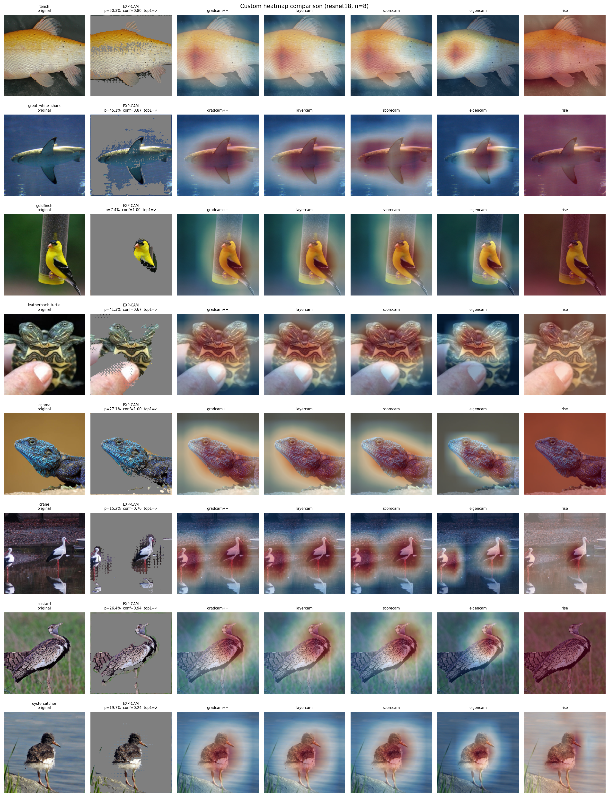

# EXP-CAM

Experiments for EXP-CAM: sequential loss ablation, mask-budget minimality, and baseline comparisons on the `trainx/` ImageNet subset.



## Setup

```bash
conda activate vae
cd /home/medal/21d180009

# Build or refresh the cached eval set (13 classes × 7 images)
python -m expcam eval-set --where local --force --out expcam_runs_wo_ce
```

## Hyperparameters (Section 0 included)

Editing `training_protocol.json` does **not** change training. That file is a notebook dump and is never loaded.

Live defaults for Section 0 (`python -m expcam 0`) and the other sections come from `config.py`:

- `DEFAULT_LAMBDAS` — λ_act, λ_ce, λ_kl, λ_area, λ_bin, λ_tv, λ_rob
- `LR`, `STEPS`, `SECTION0_STEPS`, `TEMPERATURE`, `MASK_THRESH`

Override any λ from the command line (same flags as freq_expcam, minus `--lam-energy`):

```bash
python -m expcam 0 --subset --lam-area 80 --lam-rob 50 --lam-tv 750 --where local --data-root trainX1_subset --out expcam_spatial --backbones resnet18
```

Also: `--lam-act`, `--lam-ce`, `--lam-kl`, `--lam-bin`. `--steps` and `--no-ce` still apply. After changing weights, retrain; existing `metrics.json` / `masks.pt` are not updated.

---

## Section 1 — Sequential loss ablation

Trains cumulative loss stages (`L_act` → … → `Full`) on the eval set. Outputs bar charts and qualitative mask grids per image.

```bash
# Train + figures
python -m expcam 1 --where local --out expcam_runs_wo_ce --backbones resnet18 vit_b_16

# Figures only (from saved metrics.json)
python -m expcam 1 --figures-only --where local --out expcam_runs_wo_ce --backbones resnet18 vit_b_16
```

**Outputs:** `expcam_runs_wo_ce/section1/figures_{backbone}/individual/SEQ_*.png`, `seq_qualitative/`, `FigA_SEQ_qualitative_*.png`

---

## Section 2 — Minimality (knapsack on Section 0 masks)

Post-hoc top-k knapsack sweep on Section 0 best `mask_prob` at multiple budget levels. No retraining.

```bash
# Knapsack metrics + plots + mask grids
python -m expcam 2 --from-section0-knapsack --section0-source section0_new_score \
  --where local --out expcam_runs_wo_ce --backbones resnet18 vit_b_16

# Figures only
python -m expcam 2 --from-section0-knapsack --figures-only \
  --section0-source section0_new_score \
  --where local --out expcam_runs_wo_ce --backbones resnet18 vit_b_16
```

**Outputs:** `expcam_runs_wo_ce/section2/figures_{backbone}/*.png`, `mask_grids/`

---

## Section 3 — Baseline comparison

Train EXP-CAM and compare against CAM baselines at size-matched sparsity. Per-image fair and heatmap comparison panels.

```bash
# Train EXP-CAM + run baselines + aggregate figures
python -m expcam 3 --where local --out expcam_runs_wo_ce --backbones resnet18 vit_b_16

# Per-image comparison grids only
python -m expcam 3 --figures-only --comparisons-only \
  --where local --out expcam_runs_wo_ce --backbones resnet18 vit_b_16

# Custom heatmap grid (example)
python -m expcam 3 --figures-only --comparisons-only \
  --grid-ids 006 019 030 054 061 079 \
  --where local --out expcam_runs_wo_ce --backbones resnet18
```

**Outputs:** `expcam_runs_wo_ce/section3/figures_{backbone}/comparisons_fair/`, `comparisons_heatmap/`, `FigC*.png`

---

## Module layout

| Command | Module |
|---------|--------|
| `python -m expcam 0` | `ef1.py` |
| `python -m expcam 1` | `ablation.py` |
| `python -m expcam 2` | `minimality.py` |
| `python -m expcam 3` | `comparisons.py` |

Run directories stay under `expcam_runs_wo_ce/section1/`, `section2/`, `section3/` for compatibility with existing results.
